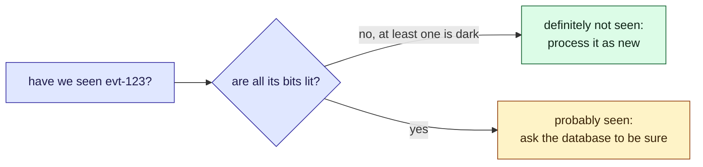

This tour is for anyone who must ask "have I seen this id before?" about a large set. After
it, you will know what a Bloom filter can answer, and what it cannot. Parcel tracker does not
use one today; this tour helps decide.

It climbs in three steps, each with its own widget: **how it works** (sixteen bits, by hand),
**where it goes wrong** (you predict, then see), and **how to size it** (the real thing, with
sliders). A short check follows each step, and a [quiz](#quiz) closes it.

## Step 1: how it works

> [!definition] Bloom filter
> A row of bits, all starting at 0, that remembers which keys were added without storing the
> keys. To **add** a key, hash it a few different ways to get a few bit numbers, and set those
> bits to 1. To **ask** about a key, hash it the same ways and look at those bits.

That is all there is to it. Walk through it with the **Next** button: four keys go in, one at a
time, then the filter is asked about one that was added and one that was not.

```widget
bloom-add
```

> [!tip] What to notice
> When asked about `evt-2`, all its bits are lit: "probably yes". When asked about a key that
> was never added, one dark bit is enough for "definitely not", because adding a key never
> turns a bit off. Notice too that `evt-4` landed on a bit `evt-1` had already lit: keys share
> bits.

```quiz
You ask a Bloom filter about a key, and one of its bits is 0. What do you know?
- [x] The key was never added
~ Adding a key sets all its bits, and nothing ever clears one. A single dark bit proves it.
- [ ] The key was probably added
~ Every added key lights all its bits. A dark bit rules it out.
- [ ] Nothing yet: you need to check the other bits
~ One dark bit already settles it. Only a "yes" needs every bit.
```

## Who is affected

| Person | What it means to them |
| --- | --- |
| **Sam**, on call | Checking every event against the database is many slow queries |
| **Dana**, at the carrier | Her feed repeats recent events on purpose, so clients can catch up |
| **Amira**, a customer | If a new event is thrown away, she never hears "out for delivery" |

## The problem, one step at a time

1. **The [poller](/parcel-tracker/architecture.md) reads Dana's feed.** It gets 200 events;
   most are already stored.
2. **It asks the database about each one.** That is 200 queries for a handful of new events.
   *Sam* sees the load.
3. **A Bloom filter answers first, from memory.** "No" means certainly new. "Yes" means
   *probably* seen.
4. **"Probably" is the catch.** Skip every "yes", and a few new events are lost. *Amira* never
   hears her parcel is out for delivery.

Step 2 shows exactly where "probably" comes from.

## Step 2: where it goes wrong

> [!definition] False positive
> The filter says "probably seen" for a key it never saw, because other keys happened to set
> all of its bits.

> [!definition] False negative
> The filter says "never seen" for a key it did see. A Bloom filter promises this never
> happens.

The same sixteen bits, now with five keys in. Before each answer appears, **make a guess**:
first about a key that was never added, then about what happens if you try to delete a key.

```widget
bloom-stranger
```

> [!tip] What to notice
> The stranger's bits were lit by other keys, and the filter keeps no record of whose bits
> they were, so it cannot tell. Deleting is worse: a key's bits are shared, so turning them
> off erases other keys too. That is why a Bloom filter never deletes.

```quiz
Why can't you delete a key from a Bloom filter by turning its bits back to 0?
- [ ] The hashes cannot be run backwards
~ You do not need to: you can hash the key again and find its bits. The trouble is who else uses them.
- [x] Other keys may share those bits, and would then look as if they were never added
~ That breaks the one promise the filter makes: "no" is always right.
- [ ] It would make false positives more likely
~ Clearing bits makes "yes" rarer, not more common. The danger is a wrong "no".
```

## Step 3: how big should it be?

Now the real size: hundreds of keys, a thousand bits, and a slider for each. You have seen
every part of it already; the question is how full it gets. Try it, in four steps. A lit cell
is a bit set to 1. The ringed cells are the bits a key hashes to.

1. **Working well.** Open on **Sized for the job**. Ask about `evt-7` (added), then `evt-999`
   (not added). The first is always "yes"; the second is almost always "no". False positives
   stay under 1%.
2. **Too small.** Click **Far too many keys**. Every bit is lit, so every answer is "maybe".
   The filter saves nothing.
3. **One hash.** Click **A single hash**. A stranger needs only one lit bit to pass, so about
   9% of them get a "yes".
4. **Too many hashes.** Click **Too many hashes**. Each key now lights sixteen bits, so the
   row fills faster. False positives are worse than with seven.

```widget
bloom-filter
```

> [!tip] What to notice
> False positives rise as the bits fill. More hashes help until they fill the row. The best
> number is about 0.69 times the bits per key.

The two answers are not equally trustworthy, and that decides where the filter goes:



## Details

> [!important] The rule
> Trust "no". Treat "yes" as a hint. A Bloom filter sits in front of the real check; it never
> replaces it.

> [!warning] Skipping on "yes" loses data
> At the widget's default size, about one new event in a hundred would be dropped, and nothing
> would report it.

> [!edge-case] It cannot forget
> There is no delete, as step 2 showed. To forget old events, rebuild the filter on a
> schedule, or use a counting variant, which keeps a small counter per bit instead of a single
> bit.

## Quiz

Three questions on the ideas above.

```quiz
A Bloom filter answers "probably seen" for a key. What do you know?
- [ ] The key was definitely added
~ Other keys may have lit all its bits. That is a false positive.
- [x] The key was either added, or it is a false positive: you cannot tell which
~ That is why a "yes" must be confirmed against the real store.
- [ ] Nothing: the answer is random
~ "No" is certain, and "yes" is right most of the time at a sensible size.
---
The poller skips any event the filter says it has seen, and never checks the database. What goes wrong?
- [ ] Duplicate events get stored
~ Duplicates are where "yes" is right. The filter does not cause them.
- [x] New events are silently dropped whenever the filter gives a false positive
~ They are never stored or notified, and nothing reports them.
- [ ] Nothing, a Bloom filter never lies
~ It never lies with a "no". A "yes" can be wrong.
---
You keep adding keys to a fixed-size Bloom filter. What happens to the share of never-added keys that get a "yes"?
- [ ] It stays the same, because the hash functions do not change
~ The hashes stay the same, but fewer bits stay dark.
- [x] It climbs towards every question being answered "yes"
~ Try "Far too many keys": every bit is lit and the filter says yes to anything.
- [ ] It falls, because the filter learns the keys
~ A Bloom filter does not learn; it only sets bits.
```
