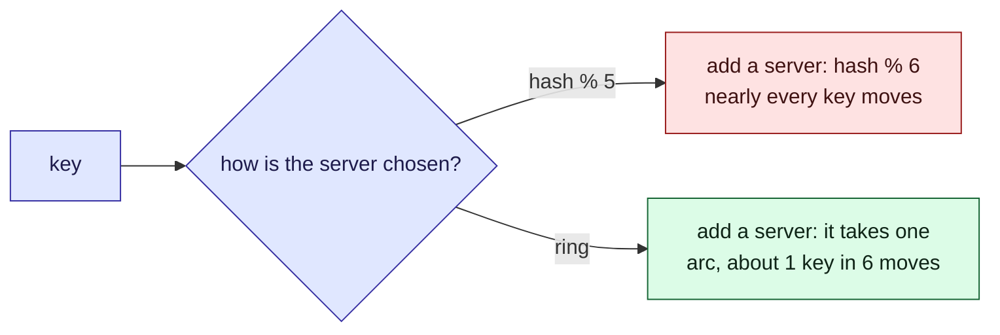

This tour is for anyone spreading data across several servers. After it, you will know how to
add a server without moving almost every key. Parcel tracker does not split its
[parcels](/parcel-tracker/data-model.md) across servers today; this tour helps decide how.

It climbs in three steps, each with its own widget: **the obvious way** and why it breaks
(twelve parcels, by hand), **the ring** that fixes it (the same twelve parcels), and **the ring
at scale** (thousands of keys). Each widget asks you to predict before it shows you. A short
check follows each step, and a [quiz](#quiz) closes it.

## Who is affected

| Person | What placement means to them |
| --- | --- |
| **Amira**, a customer | Her page is fast if her key is on the server asked, slow if not |
| **Sam**, on call | Adds a cache server before a busy day, and must not make the day worse |
| **The database** | Not a person, but it answers every cache miss, and falls over first |

## Step 1: the obvious way, `hash % servers`

> [!definition] Hash
> A function that turns a key into a number. The same key always gives the same number, and
> different keys give numbers spread evenly.

The simplest way to pick a server: hash the key, divide by the number of servers, and use the
**remainder**. With three servers the remainder is 0, 1 or 2, which picks A, B or C. It spreads
keys evenly. Walk through it with **Next**; when Sam adds a fourth server, guess how many
parcels move before you see it.

```widget
hash-modulo
```

> [!tip] What to notice
> Every hash stayed the same; only the divisor changed, and with it almost every remainder.
> In a cache, every moved key is a miss: the old server still has it, but nobody asks there.
> So adding a server to help nearly empties the cache, and the database takes the whole load.

```quiz
A cache cluster uses hash(key) % 3 and a fourth server is added. Why do most keys move?
- [ ] The hashes of the keys change
~ The hash of a key never changes. Look at the numbers on the chips: they stay the same.
- [x] The number of servers is part of the formula, so most remainders change
~ A key stays put only if its remainder happens to come out the same with 4 as with 3.
- [ ] The new server takes its fair share, a quarter of the keys
~ That is what we want, and what the ring in step 2 does. Modulo moves far more.
```

## Step 2: the ring

> [!definition] Consistent hashing
> Place servers and keys on the same circle, by hash. A key belongs to the next server
> clockwise. A new server only takes over the stretch just before it.

The same twelve parcels, now on a circle. The servers are on it too, each hashed to one point.
Walk through it: add server D (guess first), then look at how much of the circle each server
owns.

```widget
hash-ring
```

> [!tip] What to notice
> Only the parcels in D's new arc moved, and all of them went to D. Nothing moved between A,
> B and C. But with one point each, the arcs are very uneven, so one server holds most of the
> parcels. Placing each server at several points evens the arcs out.

> [!definition] Virtual node
> One server placed at many points on the circle. Many small stretches add up to about a fair
> share.

```quiz
A server joins a hash ring. Which keys can move?
- [ ] Any key, as with modulo hashing
~ That is what the ring is designed to avoid.
- [x] Only keys the new server now owns: none move between existing servers
~ The test suite checks this: a moved key always lands on the newcomer.
- [ ] Only the keys with the largest hash values
~ Position on the ring decides, and only the new server's stretches change owner.
```

## Step 3: the ring at scale

Now the real thing: 2,000 keys, up to twenty servers, and up to 256 points per server. You
have seen every part of it already. The circle is coloured by server. The bars show how many
keys each server holds. Try it, in three steps.

1. **One point each.** Open on **One point per server**. The busiest server holds about 2.3
   times the average. Read the "keys moved" lines: about 5% on the ring, about 90% with
   `hash % servers`.
2. **Evening it out.** Click **128 virtual nodes each**. The busiest server drops to about 1.2
   times the average.
3. **A bigger cluster.** Click **Twenty servers**. Adding one more moves about 4% of keys on
   the ring, and about 95% with modulo.

```widget
consistent-hash
```

> [!tip] What to notice
> The two numbers from steps 1 and 2 hold at scale: modulo moves nearly every key, the ring
> moves about one in (servers + 1). And with many points per server, no server carries much
> more than its share.

The whole tour in one picture:



## Details

> [!important] The rule
> A key's server should depend on which servers exist, not on how many there are.

> [!warning] One point per server is uneven
> Points fall unevenly on a circle, so one server can own several times its share. Virtual
> nodes even this out, at the cost of a bigger ring to store and search.

> [!edge-case] Removing a server
> Its keys move to the next server clockwise, which can overload that one neighbour. With many
> virtual nodes, they spread over many neighbours.

## Quiz

Three questions on the ideas above.

```quiz
A cache cluster uses hash(key) % 5 and a sixth server is added. What happens to the cached entries?
- [ ] About a sixth of them are now on a different server
~ That is how a ring behaves, not modulo.
- [x] Most of them are now on a different server, so most lookups miss
~ When the divisor changes, almost every remainder changes.
- [ ] None, the hash is stable
~ The hash is stable; the remainder is not.
---
Why do consistent hashing implementations give each server many points on the ring?
- [ ] To make lookups faster
~ More points make the ring bigger and the search slightly slower.
- [x] To even out how much of the ring each server owns
~ With one point each, some servers get much bigger stretches than others.
- [ ] To make keys move more often
~ The aim is the opposite: fewer moves, spread evenly.
---
Sam adds one server to a ring of nine, each with many virtual nodes. Roughly how much of the cache misses afterwards?
- [ ] Almost all of it, as with modulo
~ That is modulo. The ring moves only what the new server takes over.
- [x] About a tenth: the share the new server takes over
~ With many points each, the newcomer takes about 1/(n+1) of the ring, and only those keys move.
- [ ] None: keys never move on a ring
~ The keys in the newcomer's arcs move to it. On a cache, each of those is a miss.
```
